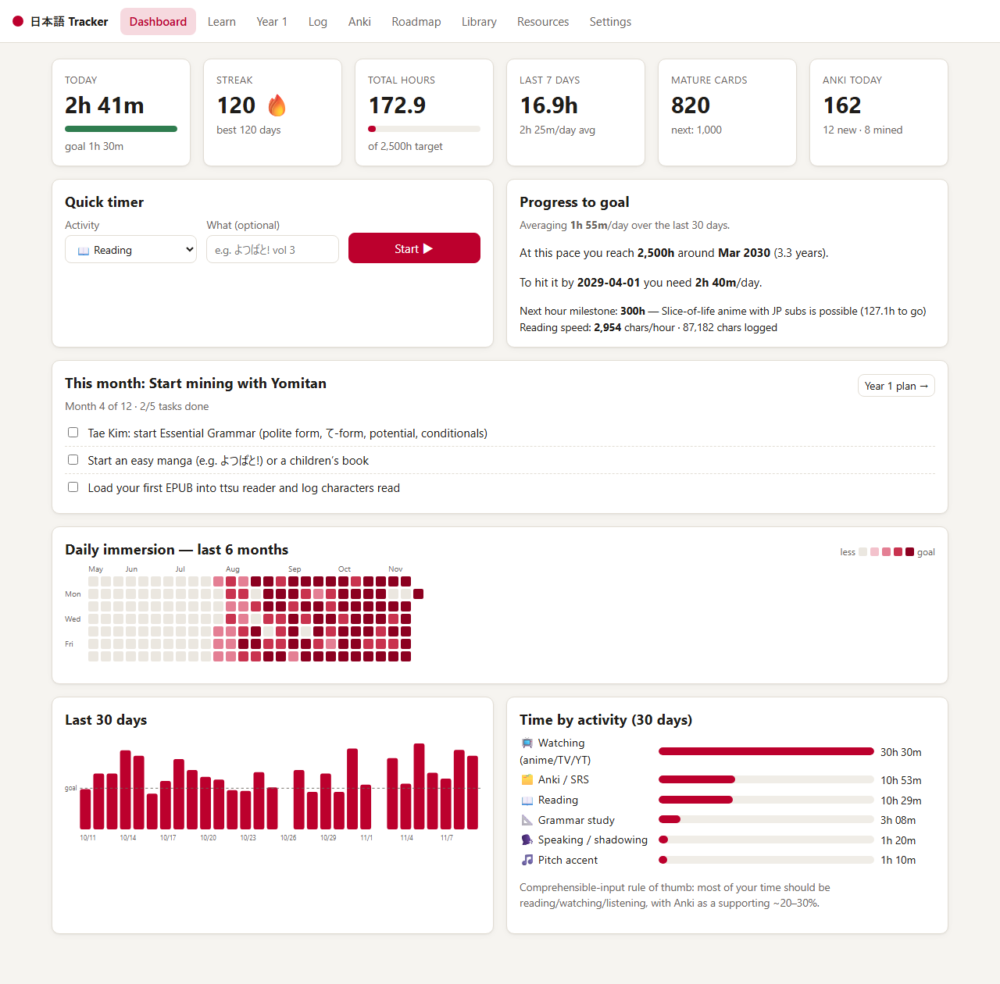
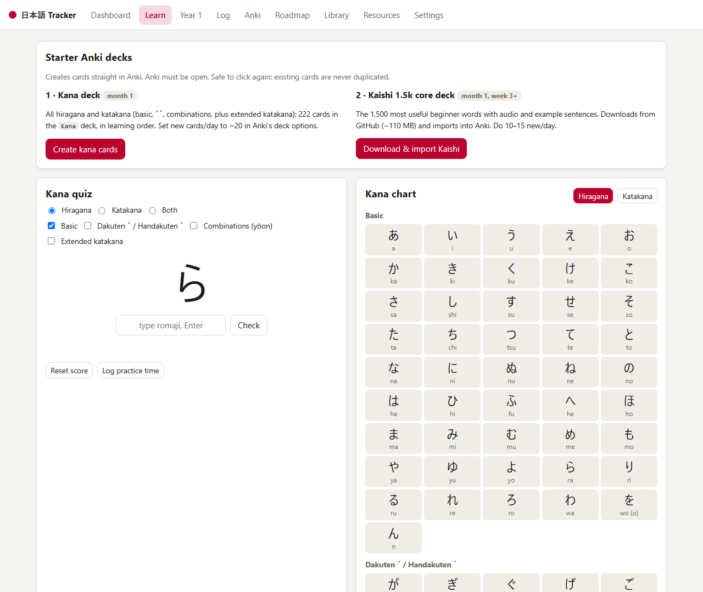
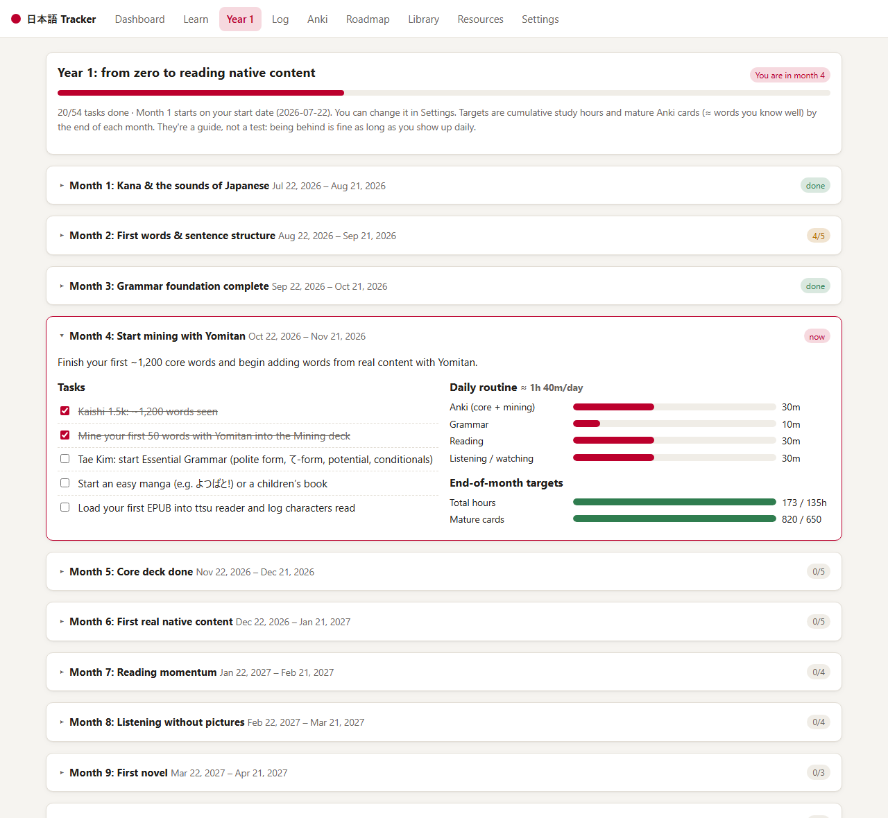
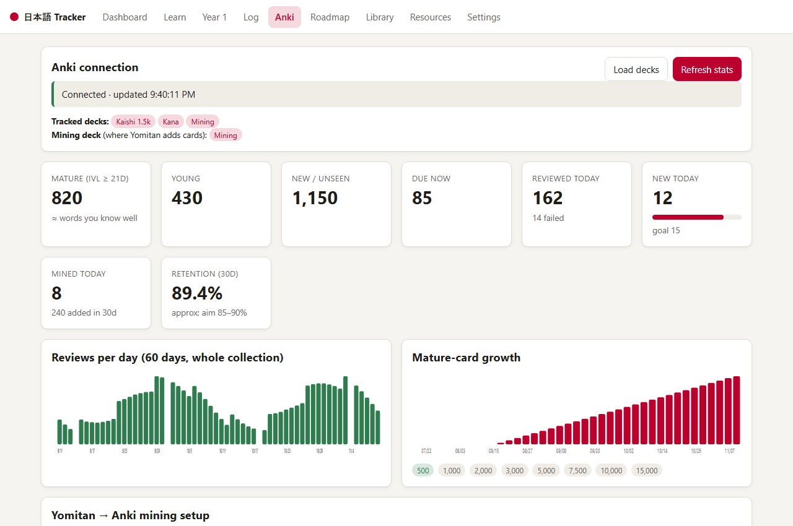

# 日本語 Tracker

A local, private study tracker for learning Japanese. It's built around comprehensible input, and the end goal is working and living in Japan.

It pulls your **Anki** stats live through AnkiConnect, logs **immersion time** (reading, watching, listening and more), keeps a **library** of what you're consuming, and walks you through a **roadmap** that goes from installing Yomitan to passing JLPT N1/BJT and job hunting.

No dependencies and no cloud: your data lives in `data/tracker.json` on your machine.



<table>
  <tr>
    <td width="50%"><br><sub><b>Learn</b>: kana quiz and chart, one-click starter Anki decks</sub></td>
    <td width="50%"><br><sub><b>Year 1</b>: monthly tasks, daily routine, targets vs. your real progress</sub></td>
  </tr>
  <tr>
    <td colspan="2"><br><sub><b>Anki</b>: live stats through AnkiConnect (mature cards, retention, reviews, mined words)</sub></td>
  </tr>
</table>

<sub>Screenshots use demo data.</sub>

> **New to Japanese?** Start with [docs/GETTING-STARTED.md](docs/GETTING-STARTED.md), a day-by-day plan for your first month.

## Quick start

1. Install [Node.js](https://nodejs.org/) 18+.
2. Double-click `start-tracker.bat`, or run:
   ```
   npm start
   ```
3. Open http://localhost:8770

### Connect Anki
1. In Anki: Tools → Add-ons → Get Add-ons → code `2055492159` (AnkiConnect). Restart Anki.
2. Keep Anki open, go to the **Anki** tab, click **Load decks**, tick your core and mining decks, then set your **mining deck** (the one Yomitan adds cards to).
3. Click **Refresh stats**. Stats also refresh automatically each time the tracker opens. The server proxies AnkiConnect, so you don't need to change AnkiConnect's CORS settings.

## Features

| Tab | What it does |
|---|---|
| Dashboard | Today vs goal, streak, total hours, 7-day average, mature cards, Anki today, a one-click **timer**, a projected date for your hour target, a 6-month heatmap, a 30-day chart and a breakdown by activity |
| Learn | Kana chart, a kana quiz that repeats the ones you miss more often, sound rules, and one-click starter decks: **Kana** (222 cards, created in Anki) and **Kaishi 1.5k** (downloaded and imported) |
| Year 1 | A 12-month beginner plan with tasks, a daily routine, and hour/mature-card targets compared with your real progress |
| Log | Manual entries (date, activity, minutes, title, characters read from ttsu, notes) and full history |
| Anki | Mature, young, new and due counts, reviews and failures today, new cards today vs goal, cards mined today, approximate 30-day retention, reviews per day, mature-card growth (a snapshot is saved daily) and a Yomitan mining setup guide |
| Roadmap | A 6-phase checklist (Setup → Kana → Core → Immersion → Intermediate → Work-ready) with completion dates, plus a JLPT N5–N1/BJT tracker |
| Library | Books, anime, podcasts and more by status. Time is matched from your logs by title, and ▶ starts a timer for that item |
| Resources | Your curated links (Anki, pitch accent, listening, dictionaries, Yomitan, grammar, reading) |
| Settings | Goals, target date, export/import JSON, import a CSV log |

## Customizing
- Roadmap items, resources, activity types and milestones are in `public/content.js`.
- Port: `PORT=9000 npm start`. Anki URL: `ANKI_URL=http://127.0.0.1:8765`. Data folder: `DATA_DIR=path/to/folder` (useful for a demo or a second profile).

## Ideas / next steps
- jpdb API integration (known-word count)
- Auto-import ttsu reader statistics
- Anki review *time* (via `cardReviews`) counted as SRS minutes automatically
- More languages (the data model isn't Japanese-specific)
